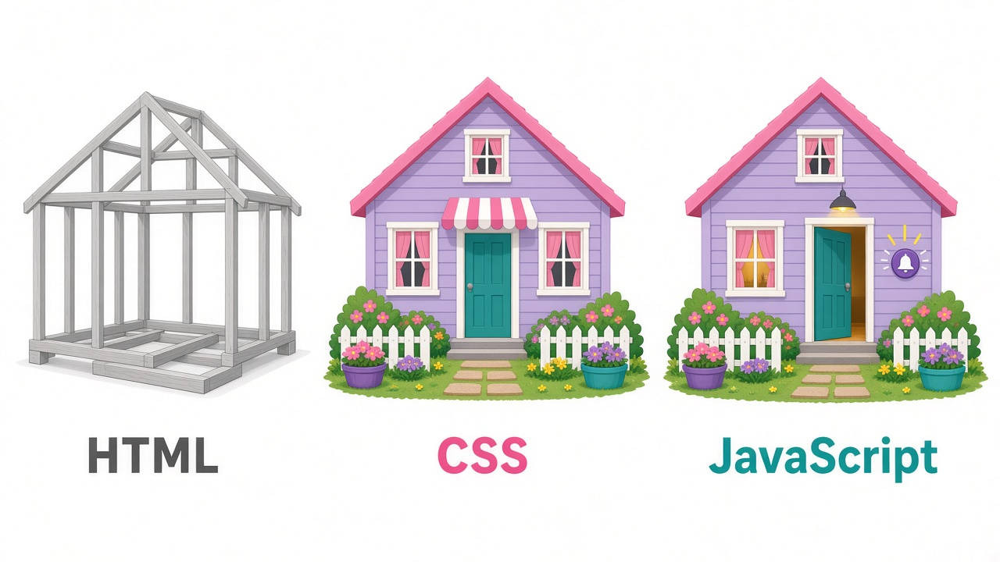

# 🧙 Coding Wizards
## Session 1: HTML and CSS
### Friday, 9 October 2026


---

# Today's plan

| Time | What |
|------|------|
| 0:00 | ⌨️ Typing practice |
| 0:25 | Recap: Figma (last time) |
| 0:35 | 📖 HTML: beginner → expert |
| 0:55 | 🎨 CSS basics |
| 1:05 | 🛠️ Build your About Me page |
| 1:20 | Wrap-up and homework |

---

# Last time: Figma 🎨

- Figma = **the plan** (what it looks like)
- HTML + CSS = **the build** (making it real)

> A designer draws the house. A developer builds it.

---

# How a website works



**HTML** = structure · **CSS** = style · **JavaScript** = behaviour. Today: **HTML + CSS**

---

# Why learn this if AI writes code?

- AI writes HTML in seconds, but **you** have to check it
- If you can't read it, you can't fix it
- Good prompts come from knowing the right words: "make the `nav` sticky", "use a `grid`"

> **Vibe coding = you are the director. The AI is the crew.**

---

<!-- LEVEL 1 -->

# 🟢 LEVEL 1: Beginner
## Your first web page

---

# Tools you need

- A **code editor**: VS Code or Cursor (free)
- A **browser**: Chrome, Edge, Firefox, or Safari
- That's it. No internet needed to build a page.

**Steps:**
1. Make a folder: `my-site`
2. Create a file: `index.html`
3. Open it in the browser (double-click the file)

---

# What is a tag?

```html preview
<p>Hello, I am a paragraph.</p>
```

- `<p>` is the **opening tag**
- `</p>` is the **closing tag** (note the `/`)
- The text in between is the **content**
- All of it together is an **element**

---

# Your first page

```html preview
<!DOCTYPE html>
<html lang="en">
  <head>
    <meta charset="UTF-8">
    <title>My First Page</title>
  </head>
  <body>
    <h1>Hello, world!</h1>
    <p>This is my first web page.</p>
  </body>
</html>
```

💡 In VS Code, type `!` and press **Tab** to get this for free.

---

# The page skeleton explained

| Part | Meaning |
|------|---------|
| `<!DOCTYPE html>` | "This is a modern HTML page" |
| `<html lang="en">` | The root. Everything goes inside it |
| `<head>` | Hidden info: title, settings, links to CSS |
| `<title>` | Text shown on the browser tab |
| `<body>` | **Everything you see on the page** |

---

# Headings

```html preview
<h1>Main title</h1>
<h2>Section title</h2>
<h3>Sub-section</h3>
<h4>Smaller</h4>
<h5>Even smaller</h5>
<h6>Smallest</h6>
```

- Use **one `<h1>` per page**
- Don't skip levels (no jumping from `h1` to `h4`)
- Headings describe **structure**, not size. CSS controls size.

---

# Text

```html preview
<p>A paragraph of text.</p>
<p>This is <strong>important</strong> and this is <em>emphasised</em>.</p>
<p>Line one<br>Line two</p>
<hr>
```

| Tag | Meaning |
|-----|---------|
| `<p>` | Paragraph |
| `<strong>` | Important (shown bold) |
| `<em>` | Emphasis (shown italic) |
| `<br>` | Line break (no closing tag) |
| `<hr>` | Horizontal divider line |

---

# Links

```html preview
<a href="https://google.com">Go to Google</a>
<br>
<a href="https://youtube.com" target="_blank">Opens in new tab</a>
<br>
<a href="mailto:me@email.com">Email me</a>
<br>
<a href="#contact">Jump to contact section</a>
```

- `href` = where the link goes
- `href` is an **attribute**: extra info written inside the opening tag

---

# Images

```html preview


```

- `src` = the image file or URL
- `alt` = a description for blind users and for when the image fails to load. **Always write one.**
- `` has **no closing tag**

---

# File paths

```
my-site/
├── index.html
├── about.html
└── images/
    └── me.jpg
```

From `index.html`:

```html
<a href="about.html">About</a>

```

- `images/me.jpg`: go into the `images` folder
- `../`: go **up** one folder

---

# Lists

```html preview
<!-- Unordered (bullets) -->
<ul>
  <li>Pizza</li>
  <li>Sushi</li>
</ul>

<!-- Ordered (numbers) -->
<ol>
  <li>Wake up</li>
  <li>Code</li>
  <li>Sleep</li>
</ol>
```

`<!-- this is a comment -->`: the browser ignores it

---

# Nesting

Tags go **inside** other tags, like boxes in boxes:

```html preview
<ul>
  <li>Fruits
    <ul>
      <li>Apple</li>
      <li>Mango</li>
    </ul>
  </li>
</ul>
```

✅ `<p><strong>Hi</strong></p>`
❌ `<p><strong>Hi</p></strong>`: close tags in reverse order

---

# 🛠️ Try it (2 min)

Make a page with:
- An `<h1>` with your name
- A `<p>` about you
- An `` (use `https://picsum.photos/300`)
- A `<ul>` of 3 hobbies
- An `<a>` to your favourite website

---

<!-- LEVEL 2 -->

# 🟡 LEVEL 2: Intermediate
## Structure, tables, and forms

---

# Block vs inline elements

| Block | Inline |
|-------|--------|
| Starts on a new line, takes the full width | Sits inside a line of text |
| `<div>`, `<p>`, `<h1>`, `<ul>`, `<section>` | `<span>`, `<a>`, `<strong>`, `` |

```html preview
<div>I am a block box</div>
<p>I am text with a <span>span inside</span>.</p>
<!-- demo -->
<style>div, p { outline: 2px dashed #a78bfa; } span { background: #fde68a; }</style>
```

*(The dashed lines show the size of each box. They're only there for this demo.)*

- `<div>` = a generic box for grouping
- `<span>` = a generic inline wrapper

---

# Attributes

```html preview
<p id="intro" class="big highlight" title="Hover text">Hover over me 👋</p>
```

| Attribute | Use |
|-----------|-----|
| `id` | A **unique** name (only one per page) |
| `class` | A **reusable** label for styling (can use many) |
| `title` | Tooltip shown on hover |
| `style` | Inline CSS (avoid it, use a CSS file instead) |

---

# Semantic HTML: tags with meaning

```html preview
<header>Logo and title</header>
<nav>Menu links</nav>
<main>
  <section>A themed group of content</section>
  <article>A blog post or card</article>
  <aside>Sidebar</aside>
</main>
<footer>© 2026 Me</footer>
<!-- demo -->
<style>
  header, nav, main, section, article, aside, footer { display: block; padding: 8px; margin: 4px; border-radius: 6px; }
  header { background: #c4b5fd; } nav { background: #f9a8d4; } main { background: #e5e7eb; }
  section { background: #bae6fd; } article { background: #bbf7d0; } aside { background: #fde68a; } footer { background: #d1d5db; }
</style>
```

**Why?** Screen readers, Google, and other developers (and AI!) understand your page better.

---

# Semantic layout picture

```
┌──────────────── header ────────────────┐
│ logo            nav: Home About Contact│
├────────────────────────────────────────┤
│ main                                   │
│  ┌─── section ────────┐ ┌── aside ──┐  │
│  │ article  article   │ │ sidebar   │  │
│  └────────────────────┘ └───────────┘  │
├──────────────── footer ────────────────┤
│ © 2026                                 │
└────────────────────────────────────────┘
```

---

# A navigation menu

```html preview
<header>
  <h1>Esther's Site</h1>
  <nav>
    <ul>
      <li><a href="index.html">Home</a></li>
      <li><a href="about.html">About</a></li>
      <li><a href="#contact">Contact</a></li>
    </ul>
  </nav>
</header>
```

---

# Tables

```html preview
<table>
  <thead>
    <tr><th>Name</th><th>WPM</th></tr>
  </thead>
  <tbody>
    <tr><td>Esther</td><td>65</td></tr>
    <tr><td>Sam</td><td>40</td></tr>
  </tbody>
</table>
<!-- demo -->
<style>table { border-collapse: collapse; } th, td { border: 1px solid #ccc; padding: 6px 14px; }</style>
```

*(Plain tables have no borders. The demo adds a little CSS so you can see the cells.)*

- `tr` = row, `th` = header cell, `td` = data cell
- Use tables for **data only**, never for page layout

---

# Forms: collecting input

```html preview
<form action="/send" method="POST">
  <label for="name">Name</label>
  <input id="name" name="name" type="text" required>

  <label for="email">Email</label>
  <input id="email" name="email" type="email">

  <label for="msg">Message</label>
  <textarea id="msg" name="msg"></textarea>

  <button type="submit">Send</button>
</form>
<!-- demo -->
<style>label, input, textarea, button { display: block; margin: 4px 0 10px; }</style>
```

`<label for="x">` connects to `id="x"`: click a label in the result and watch the box get focus. Try sending it empty!

---

# Input types

```html preview
<label>Text <input type="text"></label>
<label>Password <input type="password"></label>
<label>Number <input type="number" min="1" max="10"></label>
<label>Date <input type="date"></label>
<label>Colour <input type="color"></label>
<label>Range <input type="range"></label>
<label>File <input type="file"></label>
<label><input type="checkbox"> I agree</label>
<label><input type="radio" name="size"> Small</label>
<label><input type="radio" name="size"> Large</label>
<!-- demo -->
<style>label { display: block; margin: 8px 0; }</style>
```

On phones, `email` and `number` open the right keyboard automatically ✨

---

# More form elements

```html preview
<select name="country">
  <option value="my">Malaysia</option>
  <option value="sg">Singapore</option>
</select>

<fieldset>
  <legend>Choose a plan</legend>
  <input type="radio" id="free" name="plan"><label for="free">Free</label>
  <input type="radio" id="pro" name="plan"><label for="pro">Pro</label>
</fieldset>
```

---

# Built-in validation (no JavaScript!)

```html preview
<form>
  <input type="email" placeholder="Email" required>
  <input type="number" placeholder="Age 18–99" min="18" max="99">
  <input type="text" pattern="[0-9]{5}" placeholder="5-digit postcode">
  <button>Submit</button>
</form>
<!-- demo -->
<style>input, button { display: block; margin: 8px 0; }</style>
```

Type something wrong and press **Submit**: the browser blocks the form and shows the error by itself.

---

# Special characters (entities)

| Code | Shows |
|------|-------|
| `&lt;` | < |
| `&gt;` | > |
| `&amp;` | & |
| `&copy;` | © |
| `&nbsp;` | non-breaking space |

```html preview
<p>5 &lt; 10 &amp; 10 &gt; 5</p>
<p>&copy; 2026 Coding Wizards. I love coding 🚀</p>
```

---

<!-- LEVEL 3 -->

# 🟠 LEVEL 3: Advanced
## Media, the head, and accessibility

---

# Video and audio

```html
<video src="intro.mp4" controls width="400" poster="thumb.jpg"></video>

<audio src="song.mp3" controls></audio>
```

Embedding YouTube or Google Maps:

```html
<iframe width="560" height="315"
  src="https://www.youtube.com/embed/VIDEO_ID"
  title="YouTube video" allowfullscreen></iframe>
```

---

# Figures and captions

```html preview
<figure>
  
  <figcaption>Where the magic happens</figcaption>
</figure>
<blockquote>Code is like humour. <mark>Explain it</mark> and it's bad.</blockquote>
```

Other meaningful text tags:
`<blockquote>`, `<code>`, `<pre>`, `<mark>`, `<time datetime="2026-10-09">`, `<abbr title="HyperText Markup Language">HTML</abbr>`

---

# The `<head>`: hidden but important

```html
<head>
  <meta charset="UTF-8">
  <meta name="viewport" content="width=device-width, initial-scale=1.0">
  <title>Esther | Developer</title>
  <meta name="description" content="My personal portfolio">
  <link rel="icon" href="favicon.png">
  <link rel="stylesheet" href="style.css">
</head>
```

- `viewport` = **needed for phones** (otherwise the page looks tiny)
- `description` = the text Google shows under your link

---

# SEO and social sharing

```html
<meta property="og:title" content="Esther's Portfolio">
<meta property="og:description" content="I build websites">
<meta property="og:image" content="https://mysite.com/preview.jpg">
```

This makes your link show a nice preview card in WhatsApp, Instagram, and Discord 📱

**SEO tips:** one `h1`, meaningful headings, `alt` text, a good `title`, fast pages

---

# Accessibility (a11y)

Websites should work for **everyone**, including blind users, keyboard-only users, and people with poor eyesight.

✅ `alt` on every image
✅ `<label>` for every input
✅ Use `<button>` for actions and `<a>` for navigation
✅ Semantic tags and a proper heading order
✅ Strong colour contrast
✅ Everything usable with the **Tab** key

🧪 Test: unplug your mouse and try to use your site

---

# ARIA (when HTML isn't enough)

```html preview
<button aria-label="Close menu">✖</button>

<div role="alert">✅ Your form was sent!</div>
```

A screen reader says "Close menu, button" instead of just "✖".

**Rule #1 of ARIA:** don't use it if a native HTML tag already does the job.

---

<!-- LEVEL 4 -->

# 🔴 LEVEL 4: Expert
## Modern HTML features

---

# Interactive elements without JavaScript

```html preview
<details>
  <summary>What is HTML?</summary>
  <p>The language that structures web pages.</p>
</details>

<button onclick="popup.showModal()">Open popup</button>
<dialog id="popup">
  <p>Hello! I'm a popup.</p>
  <form method="dialog"><button>Close</button></form>
</dialog>
```

`<details>` gives you an FAQ accordion with **zero** JavaScript. Click them in the result!

---

# Responsive images

```html


<picture>
  <source srcset="photo.webp" type="image/webp">
  
</picture>
```

- Phones download small images and desktops get big ones
- `loading="lazy"` = only load the image when the user scrolls to it

---

# Data attributes, `<template>`, and more

```html preview
<button data-product-id="42" data-price="9.99">Buy</button>

<p>Download: <progress value="70" max="100"></progress></p>
<p>Battery: <meter value="0.8">80%</meter></p>

<input list="langs" placeholder="Type a language…">
<datalist id="langs">
  <option value="HTML"><option value="CSS"><option value="JavaScript">
</datalist>
```

`data-*` stores your own info for JavaScript to read later (Session 5).

---

# Graphics: SVG and canvas

```html preview
<svg width="220" height="100">
  <circle cx="50" cy="50" r="40" fill="purple" />
  <rect x="110" y="15" width="90" height="70" rx="12" fill="hotpink" />
</svg>
```

- **SVG** = vector graphics that stay sharp at any size (great for logos and icons)
- **Canvas** = drawing with JavaScript (used for games and charts)

---

# Performance and best practices

- Load CSS in the `<head>` and scripts with `<script src="app.js" defer>`
- Compress images; use WebP; set `width`/`height` so the page doesn't jump while loading
- Use `loading="lazy"` for images lower down the page
- Validate your code: [validator.w3.org](https://validator.w3.org)
- Use lowercase file names with no spaces: `about-me.html` ✅ `About Me.html` ❌
- Indent your code neatly (2 spaces)

---

# HTML expert checklist ✅

- [ ] Semantic structure (`header`, `nav`, `main`, `footer`)
- [ ] One `h1`, logical heading order
- [ ] `alt` text and labels everywhere
- [ ] Viewport, description, and favicon in the head
- [ ] Forms with the right input types and validation
- [ ] Responsive, lazy-loaded images
- [ ] Passes the W3C validator
- [ ] Works with only a keyboard

---

<!-- CSS -->

# 🎨 CSS basics
## Making it beautiful

---

# Three ways to add CSS

```html preview
<!-- 1. Inline (avoid) -->
<p style="color: red;">Inline style</p>

<!-- 2. Internal -->
<style>
  .blue { color: blue; }
</style>
<p class="blue">Internal style</p>

<!-- 3. External file (best ✅) -->
<link rel="stylesheet" href="style.css">
```

---

# CSS syntax

```css preview
h1 {
  color: purple;
  font-size: 40px;
}
/* demo */
<h1>Hello CSS!</h1>
```

Pattern: `selector { property: value; }`

- **Selector** = what to style
- **Property** = what to change
- **Value** = how to change it
- Don't forget the `;`

---

# Selectors

```css
p { }               /* every <p> */
.card { }           /* class="card" */
#hero { }           /* id="hero" */
nav a { }           /* <a> inside <nav> */
h1, h2 { }          /* both */
a:hover { }         /* when the mouse is over it */
li:first-child { }  /* first item */
input:focus { }     /* when clicked into */
```

**Specificity** (who wins): inline > `#id` > `.class` > `tag`

---

# Colours

```css preview
.name { color: red; }
.hex  { color: #8b5cf6; }
.rgb  { color: rgb(16, 185, 129); }
.see  { color: rgba(0, 0, 0, 0.35); }
.grad { background: linear-gradient(to right, #a78bfa, #f472b6); }
/* demo */
<style>p { font-size: 22px; font-weight: 700; margin: 6px 0; padding: 6px; }</style>
<p class="name">red (a name)</p>
<p class="hex">#8b5cf6 (hex)</p>
<p class="rgb">rgb(16, 185, 129)</p>
<p class="see">rgba: 35% visible</p>
<p class="grad">linear-gradient</p>
```

🎨 Pick colours from your **Figma** design, or use [coolors.co](https://coolors.co)

---

# Text and fonts

```css preview
body {
  font-family: Georgia, serif;
  font-size: 18px;
  line-height: 1.6;
  color: #333;
}
h1 {
  text-align: center;
  text-transform: uppercase;
  letter-spacing: 4px;
}
/* demo */
<h1>My Blog</h1>
<p>This paragraph uses a serif font, comfy line spacing, and dark grey text.</p>
```

Free fonts: [fonts.google.com](https://fonts.google.com). Copy the `<link>` into your `<head>`.

---

# The box model 📦

Every element is a box:

```
┌─────────── margin ───────────┐
│  ┌──────── border ────────┐  │
│  │  ┌───── padding ────┐  │  │
│  │  │     content      │  │  │
│  │  └──────────────────┘  │  │
│  └────────────────────────┘  │
└──────────────────────────────┘
```

```css preview
.card {
  padding: 20px;        /* space inside */
  border: 4px solid #a78bfa;
  margin: 16px;         /* space outside */
  border-radius: 12px;  /* rounded corners */
}
/* demo */
<style>body { background: #fde68a; margin: 0; padding: 1px; } .card { background: white; }</style>
<div class="card">I'm a card. Yellow = margin, purple = border, white = padding + content.</div>
```

Always add `* { box-sizing: border-box; }` at the top of your CSS.

---

# Sizes and units

| Unit | Meaning |
|------|---------|
| `px` | Fixed pixels |
| `%` | Percent of the parent |
| `rem` | Relative to the root font size (1rem ≈ 16px) ✅ good for text |
| `vw` / `vh` | Percent of the screen width / height |

```css
.hero { height: 100vh; }
.container { max-width: 1000px; margin: 0 auto; }  /* centred */
```

---

# Making things look modern ✨

```css preview
.card {
  background: white;
  padding: 20px;
  border-radius: 16px;
  box-shadow: 0 4px 20px rgba(0, 0, 0, 0.15);
  transition: transform 0.2s;
}
.card:hover { transform: translateY(-5px); }
button { cursor: pointer; }
/* demo */
<style>body { background: #f3f0ff; padding: 10px; } button { background: #8b5cf6; color: white; border: 0; padding: 8px 16px; border-radius: 8px; }</style>
<div class="card"><h3>Hover over me ✨</h3><button>Follow</button></div>
```

---

# A sneak peek at next week: layout

```css preview
.row {
  display: flex;
  gap: 20px;
  justify-content: center;
}
/* demo */
<style>.row div { background: #c4b5fd; padding: 20px; border-radius: 10px; font-weight: 700; }</style>
<div class="row"><div>One</div><div>Two</div><div>Three</div></div>
```

Next Friday: **Flexbox, Grid, and responsive design** (turning your Figma design into code)

---

# 🛠️ Build time: About Me page

1. Create `my-site/index.html` and `my-site/style.css`
2. Add a `header` with your name and a `nav`
3. Add `main` with a photo, a bio, and a list of hobbies
4. Add a contact `form`
5. Add a `footer` with ©
6. Style it: a font, colours, padding, rounded corners, a hover effect

**Write it by hand first.** Then ask AI: "How can I improve this design?"

---

# 🤖 Good AI prompts for today

> "Explain what each tag in this HTML does, line by line."

> "My image isn't showing. Here's my folder structure and code: …"

> "Make this page use semantic HTML and tell me what you changed."

> "Suggest a colour palette for a calm personal portfolio."

Always **read** what the AI changed. You're the director 🎬

---

# Homework 📚

- ⌨️ Typing: **10 min a day**. Write down your best WPM
- 🏠 Finish the **About Me page** by hand:
  - Semantic tags (`header`, `nav`, `main`, `footer`)
  - Photo with `alt`, bio, hobbies list, link, contact form
  - At least **8 CSS properties** + a `:hover` effect
- ⭐ Bonus: add a `<details>` FAQ and a `<table>` of your favourite things
- ⭐ Bonus: ask AI to improve the design, compare it with yours, and learn 2 new things

---

# Recap 🧠

1. **HTML** = structure, **CSS** = style
2. Use **semantic tags** and always add `alt` and `label`
3. Every element is a **box**: padding, border, margin

### See you next Friday! 🧙‍♀️
